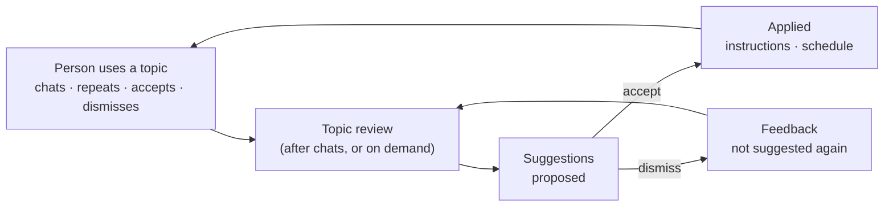
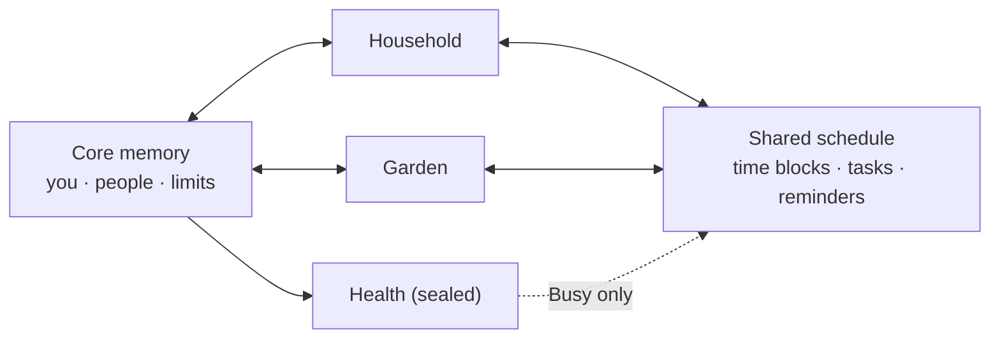
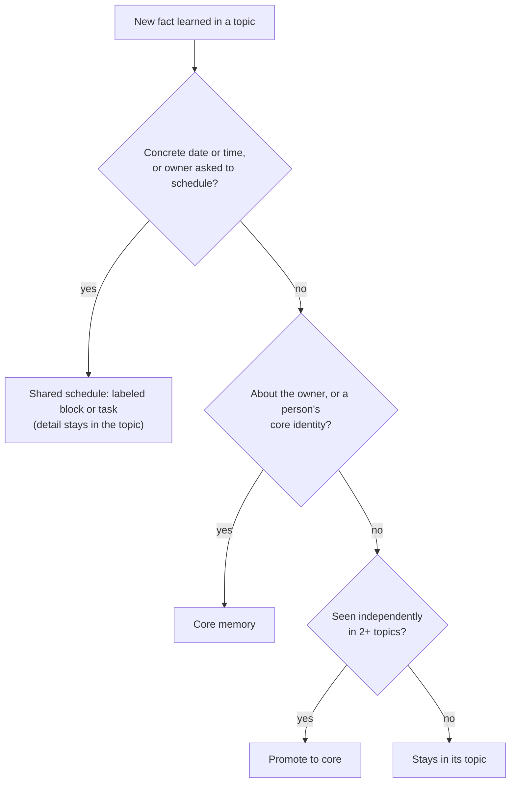

# Topics: architecture

A consumer, dashboard-first app built on Veetbot. The person has many
**topics** — an agent and dashboard per area of their life, such as Household,
Garden, Work or Health — over **one shared memory**. Each topic is run by its
own agent, and each agent keeps learning from how the person uses its topic
and suggests changes, which the person accepts or dismisses.

Status: revised 2026-10-21 (shared memory; walls and sealed topics dropped).
The topic registry, topic-tagged memory and per-topic ranking are built; the
per-topic agents and suggestions are in progress.

## Principles (current)

1. **Everything is shared.** Every topic can recall every memory and see every
   person. A topic is not a privacy boundary.
2. **A topic says who is in charge and where something was learned.** Each
   memory keeps the `topic_id` of the session that formed it (`None` is core),
   and the current topic's memories rank first (others are weighted 0.85 on the
   scope factor), so the Garden agent leads with garden facts.
3. **One agent per topic.** A topic has its own instructions, tools and model,
   applied to every session bound to it.
4. **Agents learn from use and suggest; the person decides.** Agents observe
   what the person does in their topic, propose changes, and change nothing
   until a suggestion is accepted. Dismissals are feedback, so the same
   suggestion is not made again.
5. **People are always core.** A person record is shared everywhere; a topic
   may add its own notes on how to deal with them.

## Per-topic agents

A topic carries `instructions` (and later, enabled tools and a model choice).
A session created with a `topic_id` runs the base agent plus that topic's
instructions, as an agent version of its own, the way a chat already pins its
chosen model. Changing a topic's instructions affects new sessions; existing
sessions keep the agent version they started with.

## Learning and suggestions



- **Signals:** the topic's recent user messages, its current instructions and
  schedules, and past accepted and dismissed suggestions.
- **Review:** a bounded model call per topic that returns at most a few
  suggestions, each with a short rationale citing what the person did.
- **Kinds in v1:**
  - `instructions` — add a standing preference to the topic agent's
    instructions ("Use metric units").
  - `schedule` — a recurring reminder or check-in ("Saturday 8am: what needs
    watering?"), created through Veetbot's scheduling on accept.
  - Later: dashboard changes (pin a person, add a card) and organization
    (group chats into a project), once the app reads suggestions from Veetbot.
- **Decisions:** `proposed` → `accepted` (applied) or `dismissed`. A
  suggestion's fingerprint is remembered, so a dismissed one is never re-made.

API (all under the owner's `session.read` / `session.write` scopes):

| Route | Does |
| --- | --- |
| `GET /v1/topics`, `POST /v1/topics`, `PATCH /v1/topics/{id}` | List, create, rename or change a topic's `instructions` |
| `POST /v1/sessions` with `topic_id` | Start a chat run by that topic's agent |
| `GET /v1/topics/{id}/suggestions` | The topic's open suggestions |
| `POST /v1/topics/{id}/suggestions/review` | Run a review now; returns only new suggestions |
| `POST /v1/topics/{id}/suggestions/{sid}/accept` | Apply it (instructions today; schedules next) |
| `POST /v1/topics/{id}/suggestions/{sid}/dismiss` | Dismiss it for good |

A review reads at most the topic's 20 most recent sessions and 40 latest user
messages (500 characters each), makes one structured model call on the
default chat model, and stores at most three suggestions. With the scripted
development model it proposes nothing.

## Superseded: the walled design (kept for history)

Everything from here down to "Mapping onto Veetbot" describes the first design,
in which topics were walls and sealed topics shared nothing. It was built and
then switched off on 2026-10-21: recall is no longer filtered by topic, sealed
topics are not enforced, and cross-topic promotion was removed. The `sealed`
column remains in the topics table but has no effect.

### Principles of the walled design

1. **A topic reads core plus itself, and nothing else.** Topics never read each
   other's memory, chats or people lenses.
2. **The shared plane is time.** Other topics see a topic's time blocks and due
   tasks as labels ("Garden: planting, Sat 9–11"), never the detail behind them.
3. **Centralize the effect, not the detail.** One event can produce two records:
   a labeled block in the shared schedule and the full detail inside the topic.
4. **Sealed topics share nothing but people.** A sealed topic reads core but
   writes nothing out: no promotion, no headlines, and its time appears to
   others only as `Busy`. People it meets still join core.
5. **The owner can always override.** Every memory shows where it lives and can
   be moved. Automatic routing is only the default.
6. **Walls are enforced in code, not prompts.** Isolation is a query filter and a
   write rule, never an instruction the model is asked to follow.

## Structure



| Screen | Reads | Never reads |
| --- | --- | --- |
| A topic's dashboard and chats | Core + this topic + the shared schedule (others' items as labels) | Other topics' details |
| Home | The shared schedule, due tasks and reminders for the near future, plus core | Any topic's details |
| Background jobs | Whatever the owning topic (or core) can read | Anything else |

The home screen is "what I have, or have to do, soon": upcoming time blocks,
tasks coming due, and reminders, across every topic, shown by their shared
labels (sealed items as `Busy` or a neutral "private" entry).

## Where a new memory goes

Checked in order, each time a topic learns something:



- **Time:** a block or task is created only for a concrete date or time, or
  when the owner asks. "Water the beds more often" stays in Garden; "Plant
  Saturday 9am" becomes a block.
- **Sealed topics** skip every arrow out of the topic except the schedule, and
  their schedule entries are forced to `busy`.
- **Owner corrections** ("make this core", "keep this in Garden") outrank the
  automatic rule and survive reprocessing.

## People

A person is core: name, phone numbers, email addresses, how the owner knows
them. How to deal with them is per topic, as a **lens**:

| | Core | Garden lens | Household lens |
| --- | --- | --- | --- |
| Dana, landscaper | name, phone, email | text her, casual; does the fall cleanup | invoices by email; pay within 30 days |

A topic sees only its own lens. **People are always core**, including people
first met in a sealed topic (decided 2026-10-21): every topic can see who a
person is, even if that reveals that, say, a therapist exists. The sealed rule
covers the topic's memories and schedule detail, not the person record.

## Data model

```text
Topic        id, name, icon, instructions, enabled_tools, sealed
             → one Veetbot AgentSpec per topic

Person       id, name, phones, emails, how_known        ← always core
PersonLens   person_id, topic_id, channel, tone, role, notes

Memory       id, topic_id | null (null = core), text, kind, confidence, source
             retrieval filter: topic_id = current OR topic_id IS NULL

TimeBlock    id, topic_id, start, end, shared_label, private_ref,
             visibility: labeled | busy | hidden
Task         id, topic_id, due_at, shared_label, private_ref, status,
             visibility: labeled | busy | hidden
Reminder     id, topic_id | null, remind_at, shared_label, private_ref

Headline     topic_id, text, expires_at          (never for sealed topics)
```

Other topics and Home only ever receive `shared_label`; `private_ref` resolves
only for the owning topic. For a sealed topic, visibility is forced to `busy`
and `shared_label` is replaced with a neutral label on the way out.

## Mapping onto Veetbot

| Concept | Veetbot today | Change |
| --- | --- | --- |
| The person | tenant + principal, already a hard wall | none |
| Core memory | user-scope beliefs, persona, People | mostly exists |
| A topic's personality and tools | `AgentSpec` (instructions, enabled tools, model) | one spec per topic; tool limits enforced by Veetbot's policy layer |
| Topic memory walls | "project" scope is a ranking hint only; beliefs carry everywhere by design | **main change:** `topic_id` on sessions, beliefs and episodes; "this topic or core" becomes a hard SQL filter in retrieval |
| Routing to core | portable / contextual / local classes and two-context promotion | re-aim: portable → core, everything else stays; add the time and person rules; disable promotion for sealed topics |
| People lenses | People memory, one record per person | add `PersonLens`; local people for sealed topics |
| Shared schedule | scheduled runs exist; no calendar of time claims | **new:** `TimeBlock`, `Task`, `Reminder` stores with label/detail split |
| Home headlines | none | **new, small** |
| A topic's chats | thread folders | one folder per topic, or `topic_id` on the session |

This deliberately reverses one Veetbot decision: its retrieval spec treats a
project as a relevance boundary so lessons carry everywhere. Here a topic is an
isolation boundary, and promotion (independent corroboration, or the owner's
say-so) is the only way through it.

## Known local-development limits

- In dev mode new sessions default to the scripted fake model; topic agents
  need a dev setting to choose a real model policy.
- The Apple client requires HTTPS and a bearer token; locally, the API is served
  over HTTPS on `127.0.0.1:8443` and dev mode ignores the token.

## Boards, modules and check-ins (prototype, 2026-10-21)

Agreed after the first design pass; built in `clients/topics/`.

- **A board is code built from building blocks.** Each topic's board is
  `board.json` plus TypeScript modules written against a small SDK: UI
  building blocks, `db` (the topic's own SQLite file), `draw` (SVG
  graphics), `schedule` (label-only writes to the shared plane),
  `proposals` and `agent`. Modules run in sandboxed web views with no
  network access; the app shell stays native.
- **A topic's workspace is a git repository**: the agent's notes
  (`AGENT.md` identity, `HANDOFF.md` rewritten each check-in), the board,
  the modules and the database. Every agent change is a commit, so it can
  be undone.
- **The agent doesn't run continuously.** A check-in reads the notes and
  the board, does bounded work, writes changes as blocks the app applies
  all or nothing, and leaves notes for the next one. One Veetbot session
  per topic keeps it the same helper to the owner. Locally the app applies
  the changes; the planned cloud version gives each topic its own
  Namespace machine for this.
- **The agent works on the board, not in chat.** Findings go into rows;
  decisions it needs become proposals attached to rows, which the owner
  resolves in the sidebar. The owner never sees internals.
