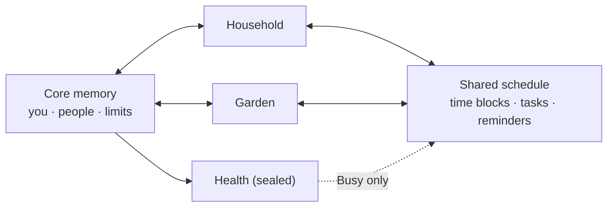
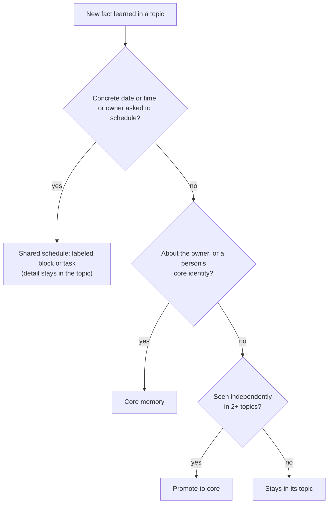

# Topics: architecture

A consumer, dashboard-first app built on Veetbot. The person has one central
**core** (who they are, the people they know, their constraints) and many
**topics** — an agent and dashboard per area of their life, such as Household,
Garden, Work or Health. Each topic keeps its own specifics. Only time —
what's scheduled and what's due — is shared across topics.

Status: design agreed 2026-10-21. Nothing is built yet.

## Principles

1. **A topic reads core plus itself, and nothing else.** Topics never read each
   other's memory, chats or people lenses.
2. **The shared plane is time.** Other topics see a topic's time blocks and due
   tasks as labels ("Garden: planting, Sat 9–11"), never the detail behind them.
3. **Centralize the effect, not the detail.** One event can produce two records:
   a labeled block in the shared schedule and the full detail inside the topic.
4. **Sealed topics share nothing.** A sealed topic reads core but writes nothing
   out: no promotion, no headlines, and its time appears to others only as
   `Busy`.
5. **The owner can always override.** Every memory shows where it lives and can
   be moved. Automatic routing is only the default.
6. **Walls are enforced in code, not prompts.** Isolation is a query filter and a
   write rule, never an instruction the model is asked to follow.

## Structure



| Screen | Reads | Never reads |
| --- | --- | --- |
| A topic's dashboard and chats | Core + this topic + the shared schedule (others' items as labels) | Other topics' details |
| Home | The shared schedule, due tasks and reminders for the near future, plus core | Any topic's details |
| Background jobs | Whatever the owning topic (or core) can read | Anything else |

The home screen is "what I have, or have to do, soon": upcoming time blocks,
tasks coming due, and reminders, across every topic, shown by their shared
labels (sealed items as `Busy` or a neutral "private" entry).

## Where a new memory goes

Checked in order, each time a topic learns something:



- **Time:** a block or task is created only for a concrete date or time, or
  when the owner asks. "Water the beds more often" stays in Garden; "Plant
  Saturday 9am" becomes a block.
- **Sealed topics** skip every arrow out of the topic except the schedule, and
  their schedule entries are forced to `busy`.
- **Owner corrections** ("make this core", "keep this in Garden") outrank the
  automatic rule and survive reprocessing.

## People

A person is core: name, phone numbers, email addresses, how the owner knows
them. How to deal with them is per topic, as a **lens**:

| | Core | Garden lens | Household lens |
| --- | --- | --- | --- |
| Dana, landscaper | name, phone, email | text her, casual; does the fall cleanup | invoices by email; pay within 30 days |

A topic sees only its own lens. **People first met in a sealed topic stay local
to it** — adding a therapist to core would reveal the therapist to every topic.
If the person already exists in core, the sealed topic adds only a private lens
and never changes the core record.

## Data model

```text
Topic        id, name, icon, instructions, enabled_tools, sealed
             → one Veetbot AgentSpec per topic

Person       id, name, phones, emails, how_known, home_topic_id | null
             (home_topic_id set only for people local to a sealed topic)
PersonLens   person_id, topic_id, channel, tone, role, notes

Memory       id, topic_id | null (null = core), text, kind, confidence, source
             retrieval filter: topic_id = current OR topic_id IS NULL

TimeBlock    id, topic_id, start, end, shared_label, private_ref,
             visibility: labeled | busy | hidden
Task         id, topic_id, due_at, shared_label, private_ref, status,
             visibility: labeled | busy | hidden
Reminder     id, topic_id | null, remind_at, shared_label, private_ref

Headline     topic_id, text, expires_at          (never for sealed topics)
```

Other topics and Home only ever receive `shared_label`; `private_ref` resolves
only for the owning topic. For a sealed topic, visibility is forced to `busy`
and `shared_label` is replaced with a neutral label on the way out.

## Mapping onto Veetbot

| Concept | Veetbot today | Change |
| --- | --- | --- |
| The person | tenant + principal, already a hard wall | none |
| Core memory | user-scope beliefs, persona, People | mostly exists |
| A topic's personality and tools | `AgentSpec` (instructions, enabled tools, model) | one spec per topic; tool limits enforced by Veetbot's policy layer |
| Topic memory walls | "project" scope is a ranking hint only; beliefs carry everywhere by design | **main change:** `topic_id` on sessions, beliefs and episodes; "this topic or core" becomes a hard SQL filter in retrieval |
| Routing to core | portable / contextual / local classes and two-context promotion | re-aim: portable → core, everything else stays; add the time and person rules; disable promotion for sealed topics |
| People lenses | People memory, one record per person | add `PersonLens`; local people for sealed topics |
| Shared schedule | scheduled runs exist; no calendar of time claims | **new:** `TimeBlock`, `Task`, `Reminder` stores with label/detail split |
| Home headlines | none | **new, small** |
| A topic's chats | thread folders | one folder per topic, or `topic_id` on the session |

This deliberately reverses one Veetbot decision: its retrieval spec treats a
project as a relevance boundary so lessons carry everywhere. Here a topic is an
isolation boundary, and promotion (independent corroboration, or the owner's
say-so) is the only way through it.

## Known local-development limits

- In dev mode new sessions default to the scripted fake model; topic agents
  need a dev setting to choose a real model policy.
- The Apple client requires HTTPS and a bearer token; locally, the API is served
  over HTTPS on `127.0.0.1:8443` and dev mode ignores the token.
