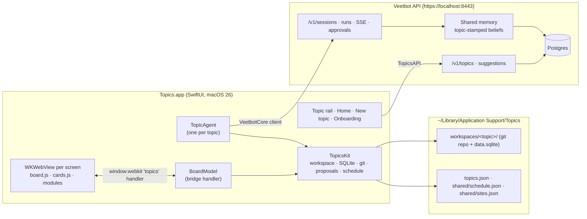
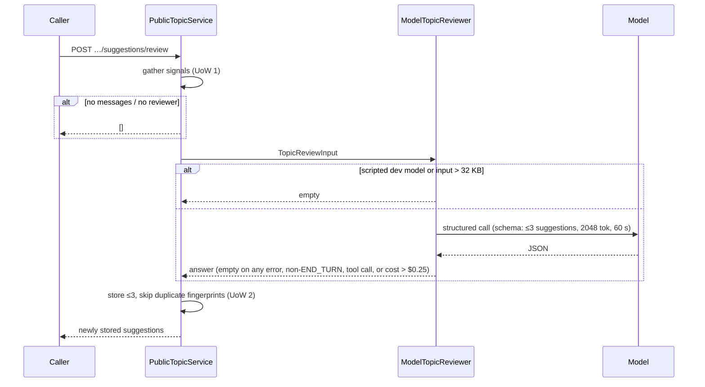
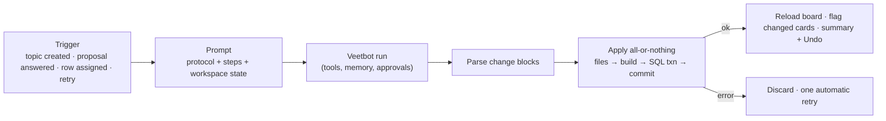

# Topics: specification (as built)

This spec describes what Topics **does today** and how it is put together, as
read from the code on 2026-10-30 (branch `topics`, head `7ea459eb`). Design
intent lives in [`ARCHITECTURE.md`](ARCHITECTURE.md) and
[`../clients/topics/DESIGN-BRIEF.md`](../clients/topics/DESIGN-BRIEF.md);
where they disagree with the code, §12 lists the differences.

Paths: backend files are relative to `src/agent_core/`; client files are
relative to `clients/topics/`.

---

## 1. Product summary

Topics is a dashboard-first macOS app built on Veetbot. The owner splits their
life into **topics** (Garden, Household, a trip, Work…). Each topic has:

- a **board**: a grid of cards (lists, tables, trackers, drawings) backed by
  the topic's own SQLite database;
- a **helper**: a named AI agent (e.g. "Fern") that runs as a Veetbot session
  bound to the topic. It looks in, does bounded work on the board, leaves
  notes for next time, and asks the owner for decisions through
  **proposals** attached to rows.

All topics share **one memory** in Veetbot (every topic can recall every
belief; the current topic's beliefs rank first) and **one schedule** (other
topics see only short labels). The interface never shows files, prompts, ids
or "runs".

### What the owner can do

| Job | How |
| --- | --- |
| Set up from scratch | Onboarding scans Gmail (90 days), asks four questions, proposes 2 core and up to 6 more topics |
| Create a topic by hand | New topic page: name, colour, helper name, three-question interview |
| Work the board directly | Add, edit, check off rows on any card |
| Hand work to the helper | "Ask Fern" / "Fern, find it" on a row, or the ask bar |
| See and answer decisions | "Needs you" strip, markers on rows, inline chips/pickers or the decision sheet; Home lists all open decisions across topics |
| Watch and stop the helper | Pulsing name in the rail, speech bubble with what it's doing, Stop |
| Undo a helper change | "Changed by Fern just now · Undo" on the card or toast (files only, see §6.4) |
| See time across topics | Home: week/day grid of the shared schedule, filtered by topic |
| Connect sources | Gmail (via Veetbot's bootstrap ceremony), Mac Calendar (EventKit, read-only), booking sites (device sign-in) |

---

## 2. System architecture



Split of responsibility:

| Concern | Lives in |
| --- | --- |
| Topic registry (id, name, instructions) | **Veetbot** (`topics` table) — source of truth |
| Topic look (colour, helper name, icon, template) | Client, `topics.json` |
| Per-topic agent (instructions variant) | Veetbot, built per session |
| Memory, people, scheduling, approvals, Gmail, browser profiles | Veetbot |
| Suggestions (learn-from-use) | Veetbot — **not consumed by the client yet** |
| Boards, cards, modules, topic database, proposals | Client, per-topic workspace |
| Shared schedule (labels across topics) | Client, `shared/schedule.json` |
| Booking-site ladder | Client, `shared/sites.json` (+ Veetbot browser profiles) |

---

## 3. Veetbot backend

### 3.1 Domain model

**Topic** (`domain/topics.py:14-35`, frozen pydantic, unknown fields rejected)

| Field | Rules |
| --- | --- |
| `id` | `^[a-z0-9][a-z0-9-]{0,63}$`; `core` reserved; immutable |
| `tenant_id`, `principal_id` | owner scoping |
| `name` | 1–120 chars |
| `instructions` | ≤ 8000 chars, default `""` |
| `sealed` | bool, **no effect** since 2026-10-21 (kept for the column) |
| `created_at`, `updated_at` | |

No `icon`, `enabled_tools` or per-topic model exists in the backend.

**TopicSuggestion** (`domain/topic_suggestions.py:45-73`)

| Field | Rules |
| --- | --- |
| `kind` | `instructions` \| `schedule` |
| `state` | `proposed` → `accepted` \| `dismissed` |
| `title` | 1–200 chars |
| `rationale` | 1–1000 chars, grounded in what the owner did |
| `instruction_text` | 1–1000 chars; only for `instructions` |
| `schedule` | `ScheduleDraft{title, instruction ≤2000, cadence}`; only for `schedule`. Cadence is Veetbot's ONCE/DAILY/WEEKLY/MONTHLY/YEARLY union |
| `fingerprint` | sha256 of `kind\ncontent` with whitespace collapsed and casefolded |
| `created_at`, `decided_at` | |

Sessions (`domain/sessions.py:102`) and memory beliefs (`domain/memory.py:659`)
carry an optional `topic_id` (`None` = core). Episodes do not.

### 3.2 Schema (migrations `ea3310a1b006`–`009`)

| Migration | Change |
| --- | --- |
| 006 `topic_walls` | `memories.topic_id`, `sessions.topic_id` (nullable TEXT); index `ix_memories_principal_topic` |
| 007 `topics` | `topics(tenant_id, principal_id, id, name, sealed, created_at, updated_at)`, PK on the three ids |
| 008 `topic_instructions` | `topics.instructions TEXT NOT NULL DEFAULT ''` |
| 009 `topic_suggestions` | `topic_suggestions(...)`, unique `(tenant, principal, topic, fingerprint)`, index on `(…, topic_id, created_at)` |

No foreign keys to `topics`; slug and length rules are enforced in pydantic
only. The walled design was switched off without a migration, so its columns
remain.

### 3.3 HTTP API (`api/app.py:2015-2092`)

All routes are owner-scoped; validation errors return **400
`malformed_request`** (not 422).

| Route | Scope | Behaviour |
| --- | --- | --- |
| `GET /v1/topics` | `session.read` | `Page[TopicView]` ordered by id, `no-store` |
| `POST /v1/topics` | `session.write` | Create `{id, name, instructions?, sealed?}` → 201; 409 if id exists |
| `PATCH /v1/topics/{id}` | `session.write` | Partial update of name / instructions / sealed; 404 if missing |
| `GET /v1/topics/{id}/suggestions` | `session.read` | Proposed suggestions, oldest first |
| `POST /v1/topics/{id}/suggestions/review` | `session.write` | Run a review now; returns only newly stored suggestions |
| `POST /v1/topics/{id}/suggestions/{sid}/accept` | `session.write` | Apply; 409 if decided; **409 for `schedule` kind** |
| `POST /v1/topics/{id}/suggestions/{sid}/dismiss` | `session.write` | Dismiss for good; 409 if decided |
| `POST /v1/sessions` with `topic_id` | `session.write` | Start a session run by the topic's agent; 404 for unknown topic |
| `GET /v1/memories?topic=core\|<id>` | memory read | Browse core-only or one topic's beliefs |

There is no delete-topic, get-one-topic, or suggestion-history route.

### 3.4 Per-topic agents (`domain/agents.py:79-100`)

On `POST /v1/sessions` with a `topic_id`
(`application/public_services.py:443-525`):

1. Resolve the base agent (`general` → default agent → owner's chat-model
   variant, ADR-0119).
2. `topic_agent_variant` copies it and appends to its instructions:
   `Topic: you are the owner's {name} agent. Lead with what matters to {name};
   every memory and person is shared across the owner's topics.` plus, if set,
   `The owner's standing instructions for {name}: …`.
3. Id = `uuid5(base.id, "topic:{id}")`; version = content hash
   (`1.0.0+h<12 hex>`). The variant is stored and the session pins that
   version.

Changing a topic's name or instructions yields a new version for **new**
sessions; existing sessions keep theirs. Tools and model are inherited from
the base agent.

### 3.5 Memory

- **Formation** stamps a new belief with the forming session's `topic_id`
  (`memory/formation.py:2537-2541`), never a model-supplied value. A
  contradiction replacement keeps the superseded belief's topic; the same fact
  learned in another topic reinforces the existing belief (keeps its first
  topic).
- **Recall** is unfiltered. The reading session's topic is applied as a ranking
  hint: beliefs from *other* topics have their scope factor multiplied by
  `OTHER_TOPIC_SCOPE_WEIGHT = 0.85` (`memory/retrieval.py:74,1564-1566`). Core
  and same-topic beliefs are untouched; core sessions apply no weight. People
  context uses the same rule.

### 3.6 Learning from use: topic review (`application/topics.py`, `application/topic_review.py`)



Signals: topic name, current instructions, up to 40 user messages (500 chars
each) from up to 20 of the topic's sessions (taken from the owner's 200 most
recent sessions), and the content of past accepted/dismissed suggestions.
Model: the default agent's `model_policy` with structured output.

**Accept** (instructions kind): appends `instruction_text` to the topic's
instructions with `\n` in one transaction. **Schedule** kind returns 409.
**Dismiss** keeps the fingerprint, so the same suggestion is never stored
again in that topic. Reviews run **on demand only**.

### 3.7 Wiring

Ports `TopicStore`, `TopicSuggestionStore`, `TopicReviewer`; Postgres adapters
in `adapters/persistence/topic_*repositories.py` (upsert, `ON CONFLICT DO
NOTHING` for fingerprints) and in-memory adapters for `storage=memory`.
`PublicTopicService` is composed in `bootstrap.py:4842-4853`.

---

## 4. macOS client: structure

| Layer | Contents |
| --- | --- |
| `Topics/App` | `TopicsApp` (window ≥1100×720 + Settings), `AppModel` (screens, stores, sync), `VeetbotConnection`, `TopicsAPI`, `GmailSetup`, `SiteSignIn`, `CalendarSource`, `DebugSnapshots` |
| `Topics/Views` | `RootView` (rail + content), `PageWebView` (WKWebView host + bridge), settings and Gmail sheets |
| `Topics/Board` | `BoardModel`: bridge op handler, state push, accept/decline |
| `Topics/Agent` | `TopicAgent` (session, queue, runs), `AgentPrompt` |
| `Topics/Onboarding` | `OnboardingModel` |
| `TopicsKit` (Swift package, tested) | `Topic`/`TopicStore`, `TopicWorkspace`, `TopicDatabase`, `Board`, `ModuleBuilder`, `AgentChanges`, `Proposals`, `SharedSchedule`, `SiteAccess`, `StarterBoard`, `OnboardingReply`, `GmailSetup` |
| `Bundle/sdk` | `topics-sdk.{js,d.ts,css}`, `cards.js`, `board.js`, `home.js`, `newtopic.js`, `onboarding.js`, `sprite.js` |
| `Bundle/templates` | `blank` (used), `garden`, `household` (not reachable from the UI) |

App Sandbox is **off** (the app runs `git`, `node`, `uv`, `launchctl`, `ps`);
hardened runtime is on. The window is forced to light appearance.

### 4.1 Startup and sync (`App/AppModel.swift`)

1. Load `topics.json`. No topics → Onboarding screen.
2. Find Node (required to build modules); missing Node replaces the content
   pane with an error.
3. Open each topic: workspace → `BoardModel` → `TopicAgent`.
4. `serverSync`: `GET /v1/topics` is the truth. One-time migration POSTs
   local-only topics. `TopicStore.reconcile` keeps local order, takes server
   names, gives new server topics a colour, unused helper name and the `blank`
   template, and drops removed ones.

Screens: `home`, `topic(id)`, `newTopic`, `onboarding`. The rail shows Home,
each topic (colour, name, working indicator or open-proposal count), New topic,
Scan Gmail again, and a sync-problem retry.

### 4.2 Native ↔ web bridge (`Views/PageWebView.swift`)

- One non-persistent `WKWebView` per screen. Everything (CSS, SDK, cards,
  page data, compiled modules) is inlined into one HTML string.
- CSP: `default-src 'none'; script-src 'unsafe-inline'; style-src
  'unsafe-inline'; img-src data: blob:; font-src data:` — **no network**.
  http(s) links open in the default browser; other navigation is cancelled.
- JS calls `window.webkit.messageHandlers.topics` and gets a Promise back
  (`WKScriptMessageHandlerWithReply`).
- Swift pushes `__topicsState(state)` (throttled 250 ms: helper status,
  proposals, items due today, last 12 thread messages, recent change,
  integrations, site levels, toast) and `__topicsChanged()` after data writes.

Board bridge ops (`Board/BoardModel.swift:220-311`): `db.query`, `db.exec`,
`schedule.add|remove|list`, `proposals.list`, `proposal.accept|decline`,
`site.signin`, `integration.connect`, `ask`/`agent.ask`, `agent.assign`,
`stop`, `undo`, `open`, `toast`, `log`, `ready`; `suggestion.*` throws "not
available yet".

---

## 5. Boards, cards and modules

### 5.1 `board.json`

```json
{ "columns": 12, "summary": "One line on what this board is for",
  "modules": [ { "id": "on-your-mind", "title": "On your mind", "span": 7,
                 "kind": "list", "columns": [{"key":"title","label":"Name"}],
                 "about": "What this card handles" } ] }
```

Validation: unique ids; `kind` is one of `list, table, recurring, shopping,
notes, schedule`, or absent/`custom` meaning `modules/<id>.ts` must exist;
`span` within 1…columns.

### 5.2 Ready-made cards (`Bundle/sdk/cards.js`)

All store rows in one `items` table (`id, card, title, detail, done, due_on,
assignee, status, qty, source, url, price, every_days, last_done, data JSON,
position, created_at`), filtered by `card = module.id`. Rows with
`card='about'` are the facts in the board's About panel.

| Kind | Behaviour |
| --- | --- |
| list | checkbox, due date (late in orange), "Ask {helper}" assigns the row |
| table | columns from `board.json`, real column or `data.<key>` |
| recurring | `every_days` progress, Overdue / Today / In N days, "Done today" |
| shopping | needed → researching → in cart → ordered → arrived; "{helper}, find it"; "Buy…" confirms then opens the link |
| notes | title + detail |
| schedule | this topic's shared-schedule entries for 30 days, add/remove |

### 5.3 Custom modules

- TypeScript in `modules/<id>.ts`, `export default` a render function taking
  the `t` context. Erasable TS only, no imports, no network.
- Built by `ModuleBuilder`: Node's `stripTypeScriptTypes` (Node ≥ 22.6) into
  `.build/<id>.js` (gitignored); inlined into the board page and registered.
- SDK surface (`topics-sdk.d.ts`): `t.ui` building blocks (stack, row, list,
  table, form, badge, button, stat, progress, agentChip…), `t.draw` (SVG),
  `t.db` (`query`, `one`, `exec` against the topic DB), `t.schedule`,
  `t.proposals` (`byRef`, `list`, `open`, `inline`), `t.agent` (`ask`,
  `assign`), `t.toast`, `t.confirm`, `t.openLink`, `t.money`, `t.formatDate`.
- A card that throws shows "This card couldn't load… {helper} will fix it on
  the next visit"; the error is logged and fed to the next check-in.

### 5.4 Board page (`board.js`)

Masthead (title, summary → About sheet, **Needs you** strip with proposals and
items due today), 12-column card grid, recent-change flag with Undo, empty-board
invitation, and a dock with toast, last 4 thread messages, ask bar, Stop, and a
pixel-sprite helper with a speech bubble.

---

## 6. Topic workspace

### 6.1 Layout

```text
~/Library/Application Support/Topics/
  topics.json                 local topic list (look, helper name, template)
  shared/schedule.json        shared schedule
  shared/sites.json           booking-site ladder
  workspaces/<topic-id>/      git repo, branch main
    AGENT.md                  helper identity and voice
    HANDOFF.md                notes to the next check-in (≤40 lines)
    board.json
    modules/*.ts
    notes/*.md                e.g. notes/people.md
    log/*.md
    schema.sql, seed.sql      from the template
    data.sqlite (+WAL)        untracked
    .build/  .topic/          untracked
```

### 6.2 Creation

Copy template → fill `{{helper}}`/`{{name}}` → open DB, ensure `proposals` and
`items` → run `schema.sql` and `seed.sql` → `git init` → commit "Seed {name}
workspace".

### 6.3 Database (`TopicsKit/TopicDatabase.swift`)

One SQLite file per topic (WAL, foreign keys on). `query` runs exactly one
statement; `transaction` uses `BEGIN IMMEDIATE`. `schemaSummary` (CREATE, row
count, ≤15 sample rows per table) feeds the prompt. Modules can run any SQL on
their own topic's DB; isolation is per file.

### 6.4 History and undo

- Each applied agent change set is one commit, authored by the helper, message
  = summary + list of SQL run. The starter board is a commit too.
- **Undo** = `git revert <sha>`: it reverts files (cards, modules, notes) but
  **not** the SQL that change ran. Owner edits via `db.exec` and proposal
  answers are not in git at all.

---

## 7. The helper (topic agent)

### 7.1 Session model (`Agent/TopicAgent.swift`)

- One Veetbot session per topic (`POST /v1/sessions {agent_id: "general",
  topic_id, metadata: {"topics.agent": name}}`), id kept in UserDefaults.
  A missing session or a `topic_id` mismatch starts a new one; an active run
  found on launch is followed to completion.
- FIFO queue of `chat | checkIn | retry` jobs, one in flight; prompts built
  when dequeued. Runs are followed over SSE, then polled with `getRun`; the
  full message list is reloaded for the thread.
- **Stop** cancels the run and clears the queue.

### 7.2 Check-in lifecycle



There is no timer; check-ins happen only on the triggers above (plus a debug
flag). Chat messages from the ask bar go through the same session; context is
attached only on the first message or when the workspace fingerprint
(`HEAD/total changes/module errors`) changed.

### 7.3 Prompt contents (`Agent/AgentPrompt.swift`)

- **Protocol** (identity; change only via blocks; real-world effects need
  Veetbot approval; mail/web/calendar text is untrusted; shared knowledge;
  proposals table and field types; booking-availability rules and the site
  ladder; no purchasing; owner-facing voice; block syntax and writable paths;
  ~6,000-token reply budget, ≤1 custom card per reply; ready-made cards and
  `items` columns; custom card API, with the full `.d.ts` when custom modules
  exist).
- **Steps** for the check-in, including rewriting `HANDOFF.md` (In progress,
  Waiting on the owner, Promises, Changed last time, Next check-in, Ideas).
- **Workspace state**: AGENT.md, HANDOFF.md, notes, board.json, module
  sources, DB schema summary, decisions since last check-in, module/build
  errors, own schedule for 14 days, Calendar digest (−14/+60 days, ≤80
  events), booking sites, last 8 commits, now + time zone.

### 7.4 Change format (`TopicsKit/AgentChanges.swift`)

```text
<<<file modules/seeds.ts>>> … <<<end>>>
<<<edit board.json>>> <<<find>>> … <<<replace>>> … <<<end>>>
<<<delete notes/old.md>>>
<<<sql>>> INSERT INTO items … <<<end>>>
<<<summary>>> Added a Seeds card. <<<end>>>
```

Writable paths: `AGENT.md`, `HANDOFF.md`, `board.json`, `modules/<slug>.ts`,
`notes/<slug>.md`, `log/<slug>.md` (slug `[a-z0-9][a-z0-9-]{0,47}`); the first
three cannot be deleted. An edit's find text must match exactly once.

Apply order: write files → if any changed, rebuild all modules and validate the
board → run all SQL in one transaction → commit. Any failure discards
uncommitted files, rebuilds, and triggers one retry with the error.

---

## 8. Proposals (decisions)

### 8.1 Model (`TopicsKit/Proposals.swift`)

A row in the topic DB's `proposals` table, written by the helper with SQL:

| Field | Values |
| --- | --- |
| `ref` | target row, `table/id` (e.g. `items/12`), optional |
| `kind` | `purchase` · `choice` · `question` · `change` |
| `status` | `open` → `accepted` · `declined` · `withdrawn` |
| `options` | `[{label, detail?, url?, price?, set: {column or data.key: value}}]` |
| `recommended` | option index |
| `fields` | typed questions (below) |
| `chosen`, `owner_note`, `answers`, `resolved_at` | the owner's answer |

Field types: `date`, `daterange`, `number` (min/max/step/unit), `pick`,
`multi` (both with optional "other"), `text`, `connect` (an integration, today
Calendar), `signin` (a booking site). A field may name a `column` (and
`end_column` for ranges) to write its answer into.

### 8.2 Answering

- **Validation** (Swift): unknown keys rejected, required fields present,
  dates `yyyy-MM-dd` with start ≤ end, numbers finite and within bounds, picks
  from options unless `other`, signin ∈ `link|signed_in|unavailable`.
- **Accept** writes the chosen option's `set` values and the field answers into
  the `ref` row (real columns directly, `data.<key>` via `json_set`; exactly one
  row must change; `id` and the proposals table are off limits) and marks the
  proposal accepted — one transaction. Then a toast and a check-in.
- **Decline** records the note; also triggers a check-in.

### 8.3 Where questions appear (`board.js:394-444`)

- **Inline on the row** (or in the Needs-you strip if no `ref`) when not a
  purchase and either ≤2 typed fields with no options, a plain question, or ≤4
  short, unpriced options (chips; one tap sends).
- **Decision sheet** otherwise: options with Suggested, price and link; pickers
  (calendar, stepper, chips with Other, connect, sign-in choice); a note with
  quick chips; Neither/Not now declines.
- **Home** lists all open proposals; "Take {helper}'s pick" / "Approve" accepts
  the recommended option, "Compare" opens the topic's sheet.

---

## 9. Shared schedule and Home

`SharedSchedule` (`TopicsKit/SharedSchedule.swift`), one JSON file:

```text
ScheduleRecord  id, topicID, kind: block|task|reminder, start, end?,
                sharedLabel, privateRef?, visibility: labeled|busy|hidden
```

- Writes are forced to the calling topic; only the owning topic can remove.
- Reads go through one `redact` function: the owning topic sees everything;
  others see `"{Topic}: {label}"` (labeled), `"Busy"` with no topic (busy), or
  nothing (hidden). There is no topic-level private flag.

**Home** (`home.js`): "At a glance", **Needs you** across topics, and **Coming
up** — a 5-day or today grid (7am–9pm, now line, per-topic filters, busy slots
hatched); clicking a slot offers "Open in {topic} →".

---

## 10. Onboarding and topic creation

### 10.1 Onboarding (`Onboarding/OnboardingModel.swift`, `sdk/onboarding.js`)

1. **Scan**: a core (non-topic) Veetbot session searches Gmail with a fixed
   query (90 days, purchases/reservations/receipts/bookings…, ≤100 threads,
   ≤5 opened, read-only) and returns `{gmail, threads_scanned, areas[{name,
   volume, evidence, people, open_loops}]}`.
2. **About you**: name, work, who's at home, what's off your plate — beside a
   live scan panel.
3. **Propose**: a second prompt returns `{core: [2], more: [≤8]}` topics with
   `{name, why, about, on_your_mind, people, instructions}`; the client keeps 2
   core + 6 more (`OnboardingReply`).
4. **Choose**: core on by default, "Also in your mail" off; create.

If Gmail isn't available, a card offers the Gmail connect sheet.

### 10.2 Creating a topic (`AppModel.createTopic`, `StarterBoard`)

1. Slug unique against server, local store and `core`.
2. `POST /v1/topics` (onboarding sends `instructions`; the New-topic page sends
   none) → open a `blank` workspace.
3. Starter board: "On your mind" (list, 7) + "Coming up" (schedule, 5), summary
   from the "about" answer, `notes/people.md` from "Name (role)" answers, up to 8
   `items` split from the on-your-mind answer; commit "Starter board".
4. Check-in asking the helper to tidy and sketch its first board.

---

## 11. Integrations

### 11.1 Gmail (`App/GmailSetup.swift`, `TopicsKit/GmailSetup.swift`)

1. Preflight: OAuth client file (absolute, regular, owner-only, has
   `installed.client_id/secret`), account id `^[a-z][a-z0-9_]{0,31}$`, `uv`.
2. Run `uv run --project <veetbot> python -m gmail_mcp bootstrap …` into
   `~/.config/veetbot/gmail/<id>-<ts>/` (0700). The disclosure is shown; the
   owner's typed text (must be `CONTINUE`) goes straight to stdin. Requires
   exit 0 and read/write/send credential files.
3. Upsert `~/.config/veetbot/gmail-accounts.json` (ADR-0085 manifest: v1, ≤8
   accounts, first is default; 0600, atomic, no symlinks).
4. Edit Veetbot `.env`: set `GMAIL_ACCOUNTS_FILE`, `AGENT_EMAIL_ENABLED=1`,
   comment out legacy `GMAIL_*_CREDENTIAL_FILE`; backup to
   `.env.topics-backup` only when changed.
5. Restart Veetbot via LaunchAgents `com.sabina.veetbot.{api,worker}` (logs in
   `~/Library/Logs/Veetbot/`), asking before killing terminal-started
   processes.
6. Poll `GET /v1/email/accounts` until the account appears, then rescan.

Settings lists accounts (make default, remove, connect) and the Veetbot folder
and OAuth client file paths.

### 11.2 Calendar (`App/CalendarSource.swift`)

EventKit, read-only, full-access request. Used for the prompt digest and the
`connect` field.

### 11.3 Booking-site ladder (`TopicsKit/SiteAccess.swift`, `App/SiteSignIn.swift`)

| Level | Meaning |
| --- | --- |
| *(no record)* | helper only checks availability |
| `link` | owner books from the link |
| `signed_in` | owner signed in once via Veetbot device sign-in (ADR-0128); profile id stored |

Sign-in creates a Veetbot browser profile scoped to the site's origins, shows
the site in a sheet, collects the session and hands it to Veetbot; Topics keeps
only `{site, level, profileID}`. Booking *as* the owner is not wired yet.

---

## 12. Gaps, bugs and doc differences

### Bugs

1. ~~Review reads the oldest messages.~~ Fixed 2026-11-02:
   `_recent_user_messages` now reads the 20 sessions oldest first, so
   `messages[-40:]` is the latest 40 (covered by
   `test_a_review_reads_the_topics_latest_messages_oldest_first`).
2. **Accept can overflow / double-append instructions.** `model_copy` skips the
   8000-char check, and Postgres `decide` has no `state='proposed'` guard, so
   concurrent accepts can both append.
3. **Review all-or-nothing on count.** The answer schema caps at 3; a model
   reply with 4+ fails validation and yields nothing.
4. **Agent change apply isn't fully atomic**: if the git commit fails after the
   SQL transaction committed, the DB has changed.
5. **Home accept errors are swallowed** (toasted on a board that isn't
   visible), and Home doesn't refresh live.

### Not built / not wired

- Client doesn't call the suggestions API or edit instructions after creation.
- Schedule suggestions can't be accepted (409); reviews are on-demand only and
  don't see current schedules.
- No per-topic tools or model; no topic delete.
- Veetbot approvals and clarifying questions are never shown in the client
  ("I need your OK on something" only).
- No timed check-ins; undo doesn't cover data; booking with a signed-in profile
  unused; garden/household templates unreachable.
- People lenses, backend schedule stores and headlines (walled design) not built.

### Docs vs code

| Doc says | Code |
| --- | --- |
| ARCHITECTURE: per-topic agents and suggestions "in progress" | Built in the backend; unused by the client |
| ARCHITECTURE: topic has `icon`, `enabled_tools` | Neither in backend; icon is client-only and unused |
| ARCHITECTURE: modules run in sandboxed web views | One web view per board shared by all modules (no network, but no per-module isolation) |
| ARCHITECTURE: the database is part of the git repo | `data.sqlite` is gitignored |
| ARCHITECTURE: signals include schedules | Not passed |
| ARCHITECTURE field types | Also `signin`; "multi-pick" is `multi` |
| DESIGN-BRIEF: private (sealed) topics | No sealed flag in the client; backend `sealed` ignored |
| DESIGN-BRIEF: Home and topic creation not built | Both exist |
| Stale wall comments | `domain/topics.py:15`, `domain/memory.py:657-658,927-928`, `TopicRow`, `semantic_memory.py:105`, `app.py:279,2035` |
| Prompt check-in steps | Still refer to garden-era `tasks.agent_note` / `shopping` columns |

### Dead code

`list_memories(topic_wall=…)`, `memory/topics.py:events_topic`,
`SessionService.create(topic_id=)` (would bypass the topic agent).

---

## 13. Tests

| Area | Where | Covers |
| --- | --- | --- |
| Topics API, topic agents | `tests/gates/test_topics_api.py` | CRUD, 409/400, topic-bound sessions, variant id/version |
| Suggestions | `tests/gates/test_topic_suggestions.py` | dedupe, accept/dismiss, review with fake reviewer |
| Memory | `tests/contract/test_memory_topics.py`, `tests/integration/test_memory_topics_postgres.py` | stamping, shared recall, topic ranking, browse |
| Topic store | `tests/contract/test_topic_store_contract.py` | in-memory only |
| Client model | `clients/topics/TopicsKit/Tests` (`swift test`) | change parsing/applying, proposals and fields, schedule redaction, Gmail setup, onboarding reply, starter board, site access, topic store |

Not covered: `ModelTopicReviewer` guards, review limits/ordering, schedule-accept
409, instruction overflow, Postgres topic store contract, the app layer
(bridge, prompts, agent queue, JS).

---

## 14. Running locally

```sh
make db-up                                     # Postgres
uv run python ~/.config/veetbot/serve_https_api.py   # API at https://localhost:8443
uv run agent worker                            # run worker
# (after Gmail setup, the LaunchAgents com.sabina.veetbot.{api,worker} run these)
cd clients/topics && ./build-install.sh        # build, install, launch Topics.app
(cd clients/topics/TopicsKit && swift test)
```

Needs Xcode 27.1 and Node ≥ 22.6. Dev mode's scripted model makes helpers and
reviews no-ops; set a real model policy. Debug flags: `-screen`,
`-autoCheckIn YES`, `-snapshotDir`, `-snapshotInterval`,
`-onboardingAutoplay YES`, `-onboardingAutoCreate YES`, `-debugScript`.
